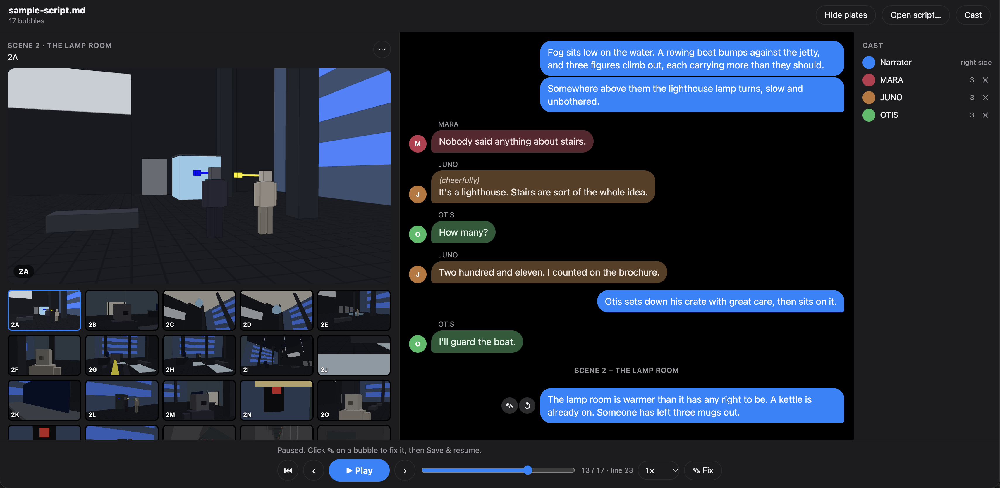

# Script Walk Through

A script reader that runs in your web browser. Open a script and watch it play out as a group chat, at talking speed.



*The sample script with optional scene plates loaded. Plate images are not included with the sample.*

## Features

- **Chat playback:** each character gets a colored bubble on the left. Narration appears in short blue bubbles on the right.
- **Talking pace:** dialogue appears word by word, at about 165 words a minute at 1× speed.
- **Playback controls:** play, pause, restart, step through bubbles, drag the position slider, or change speed (0.75× to 3×).
- **Fix as you go:** pause, correct a line or the whole script, and the chat resumes at the change.
- **Cast panel:** see each character and their number of bubbles. Double-click a name to jump to that character's next line.
- **Resume:** the reader remembers your position in each script, based on its file name.
- **Scene plates (optional):** show scene images beside the chat and change them as the script plays.
- **Light and dark mode:** the reader follows your system setting.

## Getting started

1. Download `index.html` and, if you like, `sample-script.md`.
2. Open `index.html` in your web browser. There is nothing to install.
3. Click **Choose script…** or drop a script onto the start screen. To try it first, click **Play the sample**.
4. Press **Play**. Scripts load paused.

The reader opens `.md`, `.markdown`, `.txt` and `.fountain` files. It is designed around the Markdown layouts below and does not support the full Fountain format.

## Controls

| Action | Control |
|---|---|
| Play or pause | **Play** / **Pause** button, or Space |
| Back or forward one bubble | ‹ and › buttons, or ← and → keys |
| Start over and play | ⏮ button |
| Fix the current line | **✎ Fix** button, or E |
| Fix a particular line | ✎ beside its bubble |
| Replay from a bubble | ↺ beside the bubble |
| Edit a heading or sound cue | Click it |
| Save a fix and resume | **Save & resume**, or ⌘/Ctrl + Enter |

## Fixing and saving

Click **✎ Fix**, make your change, then click **Save & resume**. Use **Edit whole script** to change anything else.

Saving depends on your browser:

- **If the browser allows direct file access** (for example, Chrome or Edge on a computer), the reader can save fixes to your file. It may ask for permission. It also watches the file, so changes saved in another editor appear in the chat.
- **Otherwise,** fixes stay in the open page. Click **Download corrected script** to keep them before you close or reload it.

Keep a backup of any script you don't want to change.

## Writing a script

### Standard layout

```markdown
## Scene 1 – The platform

Steam rolls across the platform.

**MARA:** We're going to miss it.

**JUNO (out of breath):** We are not.

MARA
(checking her watch)
Ninety seconds.
```

- Headings, and lines starting with `INT.` or `EXT.`, become scene markers.
- `NAME: text` is dialogue.
- A name in capitals on its own line can be followed by dialogue on the next lines. A blank line ends the speech.
- Text in parentheses after a name, or on the line below it, appears as a direction.
- Lines labeled `NARRATOR:` and other ordinary text are narration.

### Shot-table layout

A script can also be a Markdown table. Include a column with "Dialogue" in its heading.

```markdown
## Scene 1 – The platform

| # | Sec | Camera | Action / visual | Dialogue and sound |
|---|-----|--------|-----------------|--------------------|
| 1-01 | 4 | Wide | Steam rolls across the platform. | SFX: A train whistle. |
| 1-02 | 5 | Close | Mara checks her watch. | MARA: "Ninety seconds." |
```

- The action column becomes narration.
- A cue such as `MARA: "Ninety seconds."` becomes dialogue.
- `SFX:`, `MUSIC:` and similar labels become sound cues, as does text with no label.
- The clip, camera and duration columns appear as labels above the narration.
- In this layout, the reader mainly plays headings and table rows. Most text outside the tables is skipped. Text between a later scene heading and its table can be shown with the **Scene notes** option.

## Cast and options

Click **Cast** to show or hide the panel.

If something such as "Camera" is mistaken for a character, click ✕ beside it. Its lines in a standard script become narration. In a shot table, they become sound cues. Click **Restore** to undo this.

You can show or hide scene headings. Shot tables also have options for clip and camera labels, sound and music cues, and scene notes. Scene notes are off at first.

## Scene plates (optional)

Plates are images shown beside the chat. To match them to your script:

- **Change plates by scene:** include the scene number in each heading, such as `## Scene 2`. The first view for that scene is shown.
- **Change views within a scene:** also use a shot-table script with clip numbers such as `2-01` (scene 2, clip 1).
- **Match the episode:** put the episode code, such as `S01E01`, in the script's file name. If the script has no code and the plates folder holds only one episode, the reader uses that episode.

### Name your images

| Type | Pattern | Example |
|---|---|---|
| Plate | `<episode>_S<scene>_<scene><view>` | `S01E01_S2_2A.png` |
| Scene sheet (optional) | `<episode>_S<scene>_sheet` | `S01E01_S2_sheet.png` |

The view is a single letter. Images can be PNG, JPEG or WebP. You can add text before the episode code.

### Add a plate plan (optional)

A plate plan sets which view appears for each clip. It is a Markdown file with "plan" or "plate" in its name. Include the episode code too, for example `S01E01_plate_plan.md`.

```markdown
## Scene 2 · The lamp room

- **2A** Wide shot (clips 2-01 … 2-04)
- **2B** Close on the kettle (clips 2-05 · 2-07)
- **2C** Mara by the window (clips 2-08 … 2-12 (Mara))
```

Each view goes on one line. A name after the clips, such as `(Mara)`, links the view to that speaker. This is useful when several views cover the same clips. If no linked speaker matches, the reader chooses a view from the plan or keeps the current one.

Without a plan, a shot table's views are spread across each scene's clips in letter order.

### Load the plates

1. Open your script.
2. Click **Scene plates…** and choose the folder that holds the images and plan. Subfolders are searched too, so choose a folder dedicated to plates.
3. Press **Play**.

Click a plate to enlarge it. Click a small view below it to jump to where that view is used. If the view isn't used in the script, the reader just displays it. On narrow screens, the small views are hidden.

Some browsers can remember the plates folder and may ask you to reconnect it. Others require you to choose it again after reloading the page.

## Your files and privacy

The reader processes your scripts and images in your browser. Its code doesn't upload them. It uses browser storage for settings, playback positions and, where supported, access to your plates folder.

## License

Released under the MIT License. See [LICENSE](LICENSE).
